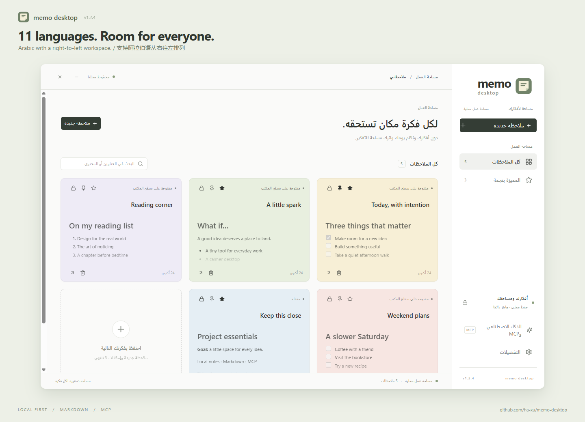

<div align="center">
  
  <h1>Memo Desktop</h1>
  <p>ملاحظات خفيفة لسطح مكتب Windows تدعم السحب وMarkdown والذكاء الاصطناعي.</p>
  <p>Windows x64 · React · Electron · 11 لغة للواجهة · MIT</p>
</div>

[简体中文](../../README.md) · [繁體中文](README.zh-TW.md) · [English](README.en.md) · [日本語](README.ja.md) · [한국어](README.ko.md) · [Deutsch](README.de.md) · [Français](README.fr.md) · [Español](README.es.md) · [Português](README.pt-BR.md) · [Русский](README.ru.md) · **العربية**

<div dir="rtl">



## الميزات

- **ملاحظات سطح المكتب**: نوافذ مستقلة مع السحب وتغيير الحجم والتثبيت فوق النوافذ والقفل والنجوم والظلال الخفيفة.
- **الطي الجانبي**: اطوِ الملاحظة يدويًا إلى لسان ضيق عند الحافة اليمنى. مرر المؤشر للمعاينة دون حجب الألسنة الأخرى؛ الانتقال إلى لسان آخر يطوي المعاينة السابقة. انقر أو اسحب لإبقائها مفتوحة.
- **Markdown**: عناوين ونص عريض ومائل وقوائم ومهام ومعاينة وتصدير بصيغة `.md`.
- **مساحة العمل**: بحث وكل الملاحظات والمميزة بنجمة والألوان والسمات والتشغيل عند تسجيل الدخول وعلبة النظام.
- **الذكاء الاصطناعي / MCP**: خدمة محلية تتيح إنشاء الملاحظات وقراءتها وتحريرها وإلحاق النص وإظهارها وإخفاءها وحذفها.
- **اللغات**: الصينية المبسطة والتقليدية والإنجليزية واليابانية والكورية والألمانية والفرنسية والإسبانية والبرتغالية والروسية والعربية. يمكن اتباع لغة النظام، وتستخدم العربية ترتيبًا من اليمين إلى اليسار.
- **تخزين محلي**: تبقى البيانات في مجلد مستخدم Windows الحالي. لا يلزم حساب للتطبيق أو مزامنة سحابية.

الدعم الرسمي هو **Windows 10/11 x64**. لم تُضمّن المنصات الأخرى وWindows ARM64 في الحزم والتحقق بعد.

## لقطات الشاشة

### ملاحظات سطح المكتب

اسحب الملاحظات وثبّتها واقفلها وأضفها إلى المفضلة.


### الطي الجانبي والمعاينة بالتمرير

اطوِ الملاحظات يدويًا إلى ألسنة جانبية، ثم مرّر المؤشر لمعاينتها مع ترك مساحة للألسنة الأخرى.


### تحرير Markdown ومعاينته

دوّن أفكارك باستخدام Markdown وانتقل إلى معاينة واضحة للقراءة.


## التثبيت والتحديث

نزّل `Memo Desktop Setup <version>.exe` من صفحة **Releases** لهذا المستودع. قارن البصمة بملف `SHA256SUMS.txt` من الإصدار نفسه:

<div dir="ltr">

```powershell
Get-FileHash -Algorithm SHA256 -LiteralPath '.\Memo Desktop Setup <version>.exe'
```

</div>

اخرج من الإصدار القديم عبر علبة النظام قبل التحديث. ملفات التثبيت غير موقعة حاليًا بتوقيع Windows، ولا ينزّل التطبيق التحديثات تلقائيًا.

يبدأ سير النشر عند دفع وسم `v<package.json.version>`. قد لا يتوفر ملف تثبيت قبل أول إصدار. راجع [دليل النشر](../RELEASING.md) باللغة الإنجليزية.

## التشغيل من المصدر

يتطلب **Windows x64 وNode.js 22.12 أو أحدث وnpm وGit**. استنسخ المستودع ونفّذ الأوامر في المجلد الجذري:

<div dir="ltr">

```powershell
npm ci
npm start
```

</div>

بعد تثبيت الاعتماديات يمكنك أيضًا فتح [`start.cmd`](../../start.cmd). يبني المصدر الحالي ويشغله بدلًا من ملف exe قديم داخل `release`. اخرج أولًا من أي إصدار آخر عبر علبة النظام.

يشترك `npm start` و`start.cmd` والتطبيق المثبّت في `%APPDATA%\Memo\memo.json`. أغلق التطبيق وانسخ الملف احتياطيًا قبل التطوير. يوفر `npm run dev` معاينة متصفح فقط، دون نوافذ سطح مكتب فعلية أو علبة نظام أو خدمة MCP.

### أوامر التطوير

| الأمر | الغرض |
| --- | --- |
| `npm ci` | تثبيت الاعتماديات وفق ملف القفل |
| `npm start` | بناء تطبيق Electron المحلي وتشغيله |
| `npm run dev` | بدء معاينة Vite في المتصفح |
| `npm test` | اختبار البيانات والطي واللغات والتشغيل والنشر |
| `npm run build` | فحص الأنواع وبناء الواجهة |
| `npm run runtime` | إعداد بيئة Electron لـWindows والتحقق منها |
| `npm run check:i18n` | فحص 11 لغة وRTL في نوافذ مخفية؛ يجب البناء وإعداد البيئة أولًا |
| `npm run check:dpi` | فحص DPI وحجم الألسنة على الشاشات المتصلة؛ يجب البناء وإعداد البيئة أولًا |
| `npm run pack` | إنشاء التطبيق غير المضغوط داخل `release/win-unpacked` |
| `npm run dist` | إنشاء مثبت NSIS دون نشر |
| `npm run package:win` | تغليف بناء موجود في مثبت Windows x64 |
| `npm run release:check` | التحقق من الإصدارات وسجل التغييرات وRELEASE_TAG إن كان محددًا |
| `npm run release:prepare` | تجهيز ملفات الإصدار والبصمات محليًا دون رفعها |

فحص CI بشاشة واحدة لا يغني عن الاختبار الحقيقي لشاشات متعددة ذات قيم DPI مختلفة. اتبع دليل المساهمة عند تعديل سلوك الانتقال بين الشاشات.

## استخدام الملاحظات

- حرّك الملاحظة من مقبض الشريط العلوي، وعدّل العنوان مباشرة فيه.
- يبقي الدبوس الملاحظة فوق النوافذ الأخرى، وتضيفها النجمة إلى المميزة. الحالتان مستقلتان.
- يخفي القفل أدوات التحرير ويمنع تغيير العنوان والنص واللون والموقع والحجم. افتح القفل قبل الحذف؛ يمكن تغيير النجمة والتثبيت مع بقاء القفل.
- لا تُطوى الملاحظة العادية إلا بالزر، وليس بفقدان التركيز أو الاقتراب من الحافة. ألغِ التثبيت أولًا. تعطيل الطي الجانبي يخفي الزر.
- يفتح تمرير المؤشر نحو 0.15 ثانية معاينة اللسان. تبقى مفتوحة فوق اللسان الأصلي أو الفجوة أو الملاحظة؛ وتُطوى بعد مغادرة المناطق الثلاث بنحو 0.45 ثانية. النقر أو السحب أو تغيير الحجم يبقيها مفتوحة.
- إغلاق الملاحظة يخفيها فقط؛ حذفها من مساحة العمل يزيل محتواها. إغلاق مساحة العمل يبقي التطبيق في علبة النظام.
- تتحكم التفضيلات في السمة واللون الافتراضي واللغة والتشغيل عند الدخول والبدء في علبة النظام والطي الجانبي.
- يمكن معرفة موقع البيانات من التفضيلات. اخرج من التطبيق قبل نسخ memo.json احتياطيًا أو استعادته.

## ربط الذكاء الاصطناعي / MCP

انسخ الإعداد من صفحة **الذكاء الاصطناعي وMCP** إلى عميل يدعم stdio MCP، وأبقِ التطبيق قيد التشغيل. يستخدم إعداد النسخة المثبتة وضع Node في Electron، فلا يلزم تثبيت Node.js منفصلًا. أثناء التطوير يمكن استخدام Node النظام؛ استبدل مسار المثال بموقع نسختك:

<div dir="ltr">

```json
{
  "mcpServers": {
    "memo": {
      "command": "node",
      "args": [
        "C:/path/to/memo-desktop/electron/mcp.cjs"
      ]
    }
  }
}
```

</div>

| الأداة | الغرض |
| --- | --- |
| `memo_list` | سرد الملاحظات وحالاتها |
| `memo_create` | إنشاء ملاحظة مع اللون والتثبيت والقفل والنجمة |
| `memo_update` | تحديث العناوين والمحتوى والألوان والحالات |
| `memo_append` | إلحاق نص بالمحتوى الحالي |
| `memo_show / memo_hide` | إظهار ملاحظات سطح المكتب أو إخفاؤها |
| `memo_delete` | حذف الملاحظات غير المقفلة |

مثال: «أنشئ ملاحظة خضراء للخطة الأسبوعية، وأضف ثلاث مهام وميّزها بنجمة».

يرسل MCP الطلبات إلى العملية الرئيسية عبر قناة محلية مسماة للمستخدم الحالي، ولا يكتب ملف البيانات مباشرة. يمكن للعملاء المتصلين قراءة الملاحظات وتعديلها عند تفعيل MCP مع احترام القفل. تستخدم عمليات العرض sandbox وcontext isolation مع تعطيل Node integration. لا يحمّل Markdown الصور الخارجية ولا يفتح الروابط تلقائيًا. راجع [ملاحظات الأمان](../../SECURITY.md) باللغة الصينية.

## المساهمة

نرحب بالإبلاغ عن الأخطاء والترجمة وتحسين التوثيق والإصلاحات. اقرأ [دليل المساهمة](../../CONTRIBUTING.md) و[سجل التغييرات](../../CHANGELOG.md) و[دليل النشر](../RELEASING.md) و[قواعد السلوك](../../CODE_OF_CONDUCT.md). دليل النشر بالإنجليزية، ووثائق الصيانة الأخرى حاليًا بالصينية، ويمكن كتابة Issues وPRs بالصينية أو الإنجليزية.

تشغّل طلبات السحب والدفع إلى الفرع الرئيسي اختبارات Windows والبناء وفحوص اللغات وDPI وإنشاء المثبت. تتوفر الملفات الناجحة ضمن Actions Artifacts. تُطلق وسوم الإصدارات سير نشر منفصلًا.

## بنية المشروع

| المجلد | المحتوى |
| --- | --- |
| `src/` | واجهة React وإعداد اللغات |
| `electron/` | النوافذ وعلبة النظام والتخزين والطي وMCP |
| `locales/` | بيانات اللغات وملفات translation.json |
| `public/` | أيقونات SVG / PNG / ICO |
| `scripts/` | بيئة التشغيل والبدء والفحص وأدوات النشر |
| `tests/` | اختبارات Node.js |
| `.github/` | قوالب Issues وPRs وسير العمل |
| `docs/` | وثائق الصيانة والنشر |

## الترخيص والشكر

المشروع مرخّص بموجب [MIT](../../LICENSE). تحتفظ الاعتماديات بتراخيصها؛ راجع [إشعارات الأطراف الثالثة](../../THIRD_PARTY_NOTICES.md).

مبني باستخدام React وElectron وBase UI ومكوّنات بأسلوب shadcn/ui وTailwind CSS وLucide وi18next وحزمة MCP SDK الرسمية.

</div>
