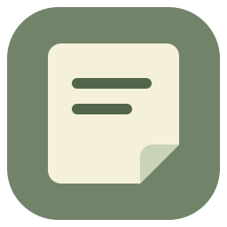
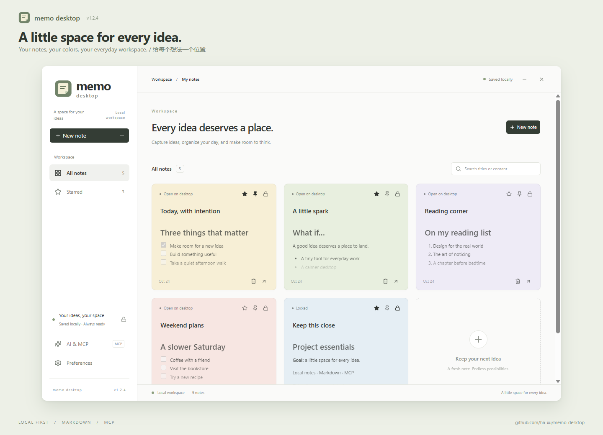
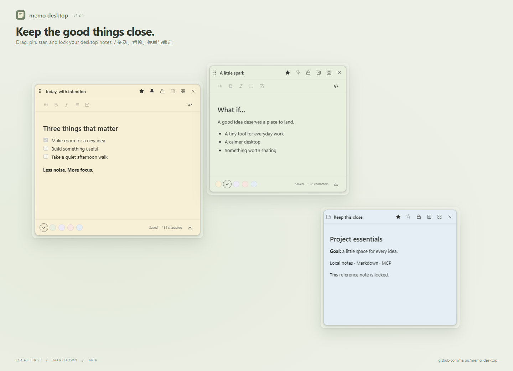
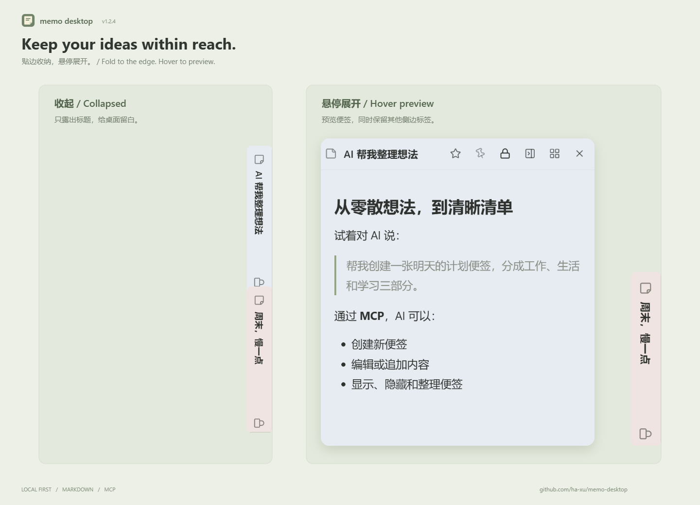
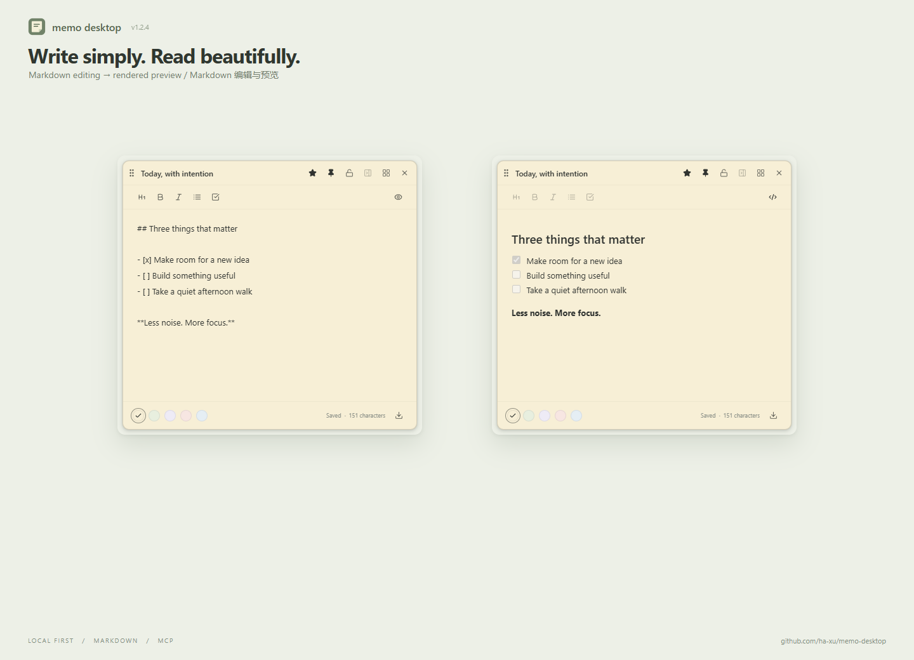

<div align="center">
  
  <h1>Memo Desktop</h1>
  <p>Lightweight Windows desktop notes with drag-and-drop, Markdown, and AI.</p>
  <p>Windows x64 · React · Electron · 11 interface languages · MIT</p>
</div>

[简体中文](../../README.md) · [繁體中文](README.zh-TW.md) · **English** · [日本語](README.ja.md) · [한국어](README.ko.md) · [Deutsch](README.de.md) · [Français](README.fr.md) · [Español](README.es.md) · [Português](README.pt-BR.md) · [Русский](README.ru.md) · [العربية](README.ar.md)



## Features

- **Desktop notes**: independent windows, dragging, resizing, always-on-top, locking, stars, and soft shadows.
- **Edge docking**: manually fold a note into a narrow right-edge tab. Hover to preview without covering other tabs; switching tabs retracts the previous preview. Click or drag to keep a note open.
- **Markdown**: headings, bold, italics, lists, tasks, preview, and `.md` export.
- **Workspace**: search, all notes, starred notes, colors, themes, login startup, and tray controls.
- **AI / MCP**: a local service lets AI create, read, edit, append, show, hide, and delete notes.
- **Languages**: Simplified Chinese, Traditional Chinese, English, Japanese, Korean, German, French, Spanish, Portuguese, Russian, and Arabic. Follow the system language or choose one; Arabic uses RTL.
- **Local storage**: notes stay in the current Windows user’s data directory. No app account or cloud synchronization is required.

Officially supported: **Windows 10/11 x64**. Other platforms and Windows ARM64 are not included in packaging or validation.

## Screenshots

### Desktop notes

Drag, pin, lock, and star independent desktop notes.



### Edge docking and hover preview

Manually fold notes into edge tabs. Hover to preview while leaving room for other tabs.



### Markdown editing and preview

Capture ideas in Markdown and switch to a clean reading preview.



## Install and update

Download `Memo Desktop Setup <version>.exe` from this repository’s **Releases** page. Verify it against `SHA256SUMS.txt` from the same release:

```powershell
Get-FileHash -Algorithm SHA256 -LiteralPath '.\Memo Desktop Setup <version>.exe'
```

Quit the old version from the system tray before installing an update. Installers are currently unsigned; the app does not download updates automatically.

Pushing a `v<package.json.version>` tag triggers the release workflow. An installer may not exist before the first release. See the [release guide](../RELEASING.md) (English).

## Run from source

Requires **Windows x64, Node.js 22.12 or newer, npm, and Git**. Clone the repository, open its root directory, and run:

```powershell
npm ci
npm start
```

After installing dependencies, you can also double-click [`start.cmd`](../../start.cmd). It builds and starts the current source, rather than an old executable under `release`. Quit any other running version from the tray first.

`npm start`, `start.cmd`, and the installed app share `%APPDATA%\Memo\memo.json`. Exit the app and back up this file before development. `npm run dev` is a browser preview without real desktop windows, tray, or MCP service.

### Development commands

| Command | Purpose |
| --- | --- |
| `npm ci` | Install dependencies from the lockfile |
| `npm start` | Build and start the local Electron app |
| `npm run dev` | Start the Vite browser preview |
| `npm test` | Run data, docking, language, launcher, and release tests |
| `npm run build` | Typecheck and build the frontend |
| `npm run runtime` | Prepare and verify the Windows Electron runtime |
| `npm run check:i18n` | Check 11 languages and RTL in hidden windows; build and prepare the runtime first |
| `npm run check:dpi` | Check DPI and edge-tab sizing on connected displays; build and prepare the runtime first |
| `npm run pack` | Build the unpacked app in `release/win-unpacked` |
| `npm run dist` | Build an NSIS installer without publishing |
| `npm run package:win` | Package an existing build as a Windows x64 installer |
| `npm run release:check` | Validate versions and changelog; also validates `RELEASE_TAG` when set |
| `npm run release:prepare` | Stage release assets and checksums locally; does not upload |

A single-display CI check cannot replace real mixed-DPI testing. Follow the contribution guide when changing cross-display behavior.

## Using notes

- Move a note with its title-bar grip; edit the title directly in the title bar.
- The pin keeps a note above other windows. The star adds it to Starred. These states are independent.
- Locking hides editing tools and prevents changes to text, title, color, movement, and resizing. Unlock before deleting; stars and pinning can still be changed.
- Only the docking button folds a normal note. Losing focus or approaching an edge does not. Unpin before docking; disabling edge docking hides the button.
- Hovering a folded tab for about 0.15 seconds opens a preview. It stays open over the original tab, gap, or note; leaving all three retracts it after about 0.45 seconds. Clicking, dragging, or resizing keeps it open.
- Closing a note hides it; deleting it in the workspace removes its content. Closing the workspace keeps the app in the tray.
- Preferences control theme, default color, language, login startup, start-to-tray, and edge docking.
- Find the data location in Preferences. Exit the app before backing up or restoring `memo.json`.

## Connect AI / MCP

Copy the client configuration from **AI & MCP** into a client supporting stdio MCP. Keep the desktop app running. Installed-app configurations use Electron’s Node mode, so a separate Node.js installation is unnecessary. For development, you may use system Node; replace the example path with your clone’s location:

```json
{
  "mcpServers": {
    "memo": {
      "command": "node",
      "args": [
        "C:/path/to/memo-desktop/electron/mcp.cjs"
      ]
    }
  }
}
```

| Tool | Purpose |
| --- | --- |
| `memo_list` | List notes and their states |
| `memo_create` | Create notes with color, pin, lock, and star options |
| `memo_update` | Update titles, content, colors, and states |
| `memo_append` | Append text without replacing existing content |
| `memo_show / memo_hide` | Show or hide desktop notes |
| `memo_delete` | Delete unlocked notes |

Example: “Create a green weekly-plan note, add three tasks, and star it.”

MCP sends requests to the main process through the current user’s local named pipe; it does not write the data file directly. Connected clients can read and modify notes while MCP is enabled, and locking rules apply. Renderers use sandbox and context isolation with Node integration disabled. Markdown does not automatically load external images or open links. See [security notes](../../SECURITY.md) (Chinese).

## Contributing

Bug reports, translations, documentation, and fixes are welcome. Read the [contribution guide](../../CONTRIBUTING.md), [changelog](../../CHANGELOG.md), [release guide](../RELEASING.md), and [code of conduct](../../CODE_OF_CONDUCT.md). The release guide is in English; the other maintenance documents are currently in Chinese; issues and PRs may be written in Chinese or English.

PRs and main-branch pushes run Windows tests, builds, language/DPI checks, and installer packaging. Successful installers are available in Actions Artifacts. Version tags trigger a separate release workflow.

## Project layout

| Directory | Contents |
| --- | --- |
| `src/` | React UI and client localization |
| `electron/` | Windows, tray, storage, docking, and MCP |
| `locales/` | Language metadata and translation.json files |
| `public/` | Application SVG / PNG / ICO icons |
| `scripts/` | Runtime, launcher, checks, and release tools |
| `tests/` | Node.js tests |
| `.github/` | Issue / PR templates and workflows |
| `docs/` | Maintenance and release documentation |

## License and acknowledgments

Licensed under the [MIT License](../../LICENSE). Dependencies retain their own licenses; see [third-party notices](../../THIRD_PARTY_NOTICES.md).

Built with React, Electron, Base UI, shadcn/ui-style components, Tailwind CSS, Lucide, i18next, and the official MCP SDK.
